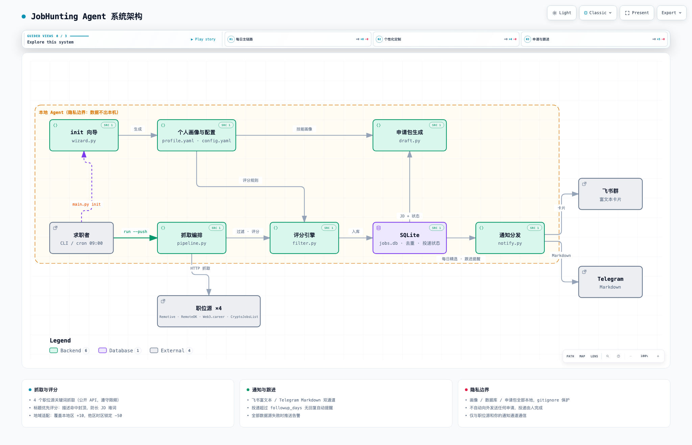

# JobHunting Agent 🤖

**A personal job-search agent** — it watches remote job boards, scores every
opening *against your profile*, pushes a daily digest to your chat, drafts
tailored application materials, and nags you to follow up.

```
fetch → filter → score (title-first, location-aware) → notify → draft → follow up
```

📐 **[交互式架构图](docs/architecture.html)** — 组件、数据流、隐私边界，支持明/暗主题与章节导览。



> 🇨🇳 中文简介见下方。个人求职 Agent：自动抓取远程职位、按你的画像评分、
> 每日推送到飞书/Telegram、一键生成定制申请包、投递超时自动提醒跟进。

## Why

Job boards are firehoses. What you need is an agent that knows **your** stack,
**your** location constraints, and **your** strongest projects — and only
surfaces the openings worth your time, with materials ready to send.

## Features

- **4 sources, keyword-driven**: Remotive API, RemoteOK API, Web3.career,
  CryptoJobsList (blockchain/Crypto focus; easy to add more in `sources/`)
- **Title-first scoring** — long JDs can't keyword-stuff their way to the top;
  generic talent-marketplace listings (Lemon.io, Toptal…) are penalized
- **Location-aware**: +bonus when a posting covers your region (e.g. APAC),
  −penalty when it's US/EU-timezone-locked or on-site in a city you can't work from
- **Daily digest**: Feishu (Lark) rich card or Telegram Markdown
- **LLM-powered agent** (`chat`): conversational interface for any job posting:
  - `chat --fit <job_id>` — LLM reads full JD + your profile → match score,
    honest strengths/gaps analysis, salary hint, and apply recommendation
  - `chat --draft <job_id>` — LLM writes a genuine personalized cover letter
  - `chat <job_id> "your question"` — ask anything about a job in plain English
  - `chat <job_id>` — interactive Q&A mode (type questions, get answers)
- **Template-free drafting** (`draft`): fit verdict, keyword-ranked resume tips,
  and likely interview questions — works offline, no LLM needed
- **Follow-up tracking**: `applied` starts a timer; no reply after N days →
  you get a nudge; `replied` stops it
- **Ops-ready**: SQLite with auto-pruning, rotating logs, run history,
  alert when all sources fail, unit tests

Everything personal lives in `profile.yaml` + `.env` — both gitignored.

### LLM agent (optional)

Set `llm.enabled: true` in `config.yaml`, then configure API credentials via
environment variables or in `config.yaml`:

```yaml
llm:
  enabled: true
  # provider: anthropic          # MiniMax / DeepSeek 等兼容 Anthropic 协议
  # api_key: sk-your-key
  # base_url: https://api.minimaxi.com/anthropic
  # model: MiniMax-M2.7-highspeed
```

Or export the corresponding env vars (`AI_INVESTMENT_LLM_API_KEY` etc. —
compatible with FI-Agent credentials). Run `python main.py chat --fit <job_id>`
to verify.

## Quick start

```bash
git clone <this-repo> && cd jobhunting
python3 -m venv .venv && .venv/bin/pip install -r requirements.txt

# 1) Interactive onboarding — builds your profile.yaml + config.yaml
.venv/bin/python main.py init

# 2) Configure a notification channel (optional but recommended)
cp .env.example .env   # fill in Feishu OR Telegram credentials

# 3) First run
.venv/bin/python main.py run --push
```

### Daily workflow

```bash
# Morning digest arrives in your chat (cron/launchd — see below)

# Pick a job ID from the digest, then:
.venv/bin/python main.py draft remoteok:remote-xxx-123   # application kit in ~1s

# Edit the cover letter to your voice, apply on the site, then:
.venv/bin/python main.py applied remoteok:remote-xxx-123  # starts follow-up timer

# When they reply:
.venv/bin/python main.py replied remoteok:remote-xxx-123
```

### Automate (weekdays 09:00)

```bash
crontab -e
0 9 * * 1-5 cd /path/to/jobhunting && .path/to/.venv/bin/python main.py run --push >> logs/cron.log 2>&1
```

## Commands

| Command | What it does |
|---|---|
| `init` | Interactive onboarding (profile + scoring config, region-aware) |
| `run [--push]` | Fetch → filter → score → store; optionally notify |
| `list -n 20` | Recent jobs |
| `chat --fit <job_id>` | LLM 深度匹配分析（JD + 画像 → 真实匹配分/优势/缺口/推荐） |
| `chat --draft <job_id>` | LLM 生成定制 Cover Letter（完全自然语言版） |
| `chat <job_id> "question"` | LLM 对话：直接问职位相关问题 |
| `chat <job_id>` | LLM 交互式 Q&A（逐条提问） |
| `draft <job_id>` | Application kit (无 LLM 模式): fit verdict + resume tips + interview questions |
| `applied <job_id>` | Mark applied (starts follow-up timer) |
| `replied <job_id>` | Log a reply (stops follow-up reminders) |
| `followups [--push]` | List/push stale applications |
| `push -d 7` | Push top-scored jobs from the last N days |
| `rescore` | Recompute all scores after tuning `config.yaml` |
| `config` | Show effective config |

## How scoring works

| Signal | Weight |
|---|---|
| Core keyword hit in **title** | ×20, uncapped (strongest signal) |
| Core keyword hits in description | ×10, capped at 3 (anti-stuffing) |
| Secondary keyword hits | ×5, capped at 4 |
| Salary transparency | +10 |
| Talent marketplace (Lemon.io, Toptal…) | −30 |
| Location covers your region (APAC/EU/US — auto from `init`) | +10 |
| Location locked to another timezone / on-site city | −50 |
| Empty title | 0 (never recommended) |

Default threshold: 40. Tune everything in `config.yaml`, then `rescore`.

## Project layout

```
├── main.py                    # CLI entry
├── config.yaml                # generated by `init` — sources, scoring, notify
├── profile.example.yaml       # copy to profile.yaml (gitignored)
├── src/jobhunting/
│   ├── wizard.py              # interactive onboarding
│   ├── pipeline.py            # fetch → score → store → notify
│   ├── filter.py              # scoring engine (title-first, location-aware)
│   ├── draft.py               # application-kit generator
│   ├── notify.py              # Feishu + Telegram
│   ├── db.py                  # SQLite, pruning, follow-up state
│   └── sources/               # Remotive / RemoteOK / Web3Career / CryptoJobsList
└── tests/test_filter.py       # scoring unit tests
```

## Adding a source

Subclass `JobSource`, implement `fetch()` + `normalize()`, register in
`sources/__init__.py`. APIs preferred; respect robots.txt and rate limits —
**please don't add LinkedIn/Indeed scrapers** (ToS violations, account bans).

## Privacy

- `profile.yaml`, `.env`, `data/`, `drafts/`, `logs/` are gitignored
- No telemetry; the agent only talks to job boards and your notification channel
- Cover letters are generated locally from your profile — nothing is sent anywhere automatically

## Contributing

PRs welcome — especially new sources (public APIs), notification channels
(Slack, Discord, email), and scoring improvements. See [CONTRIBUTING.md](CONTRIBUTING.md).
Run tests before submitting: `.venv/bin/python tests/test_filter.py`

## License

[MIT](LICENSE)
